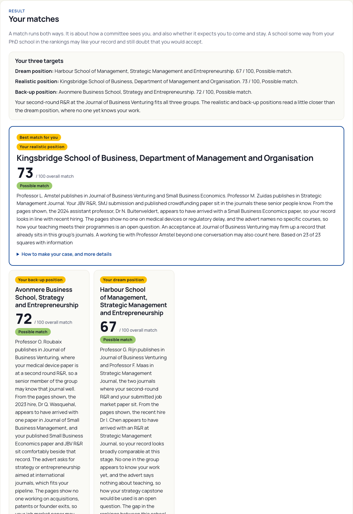
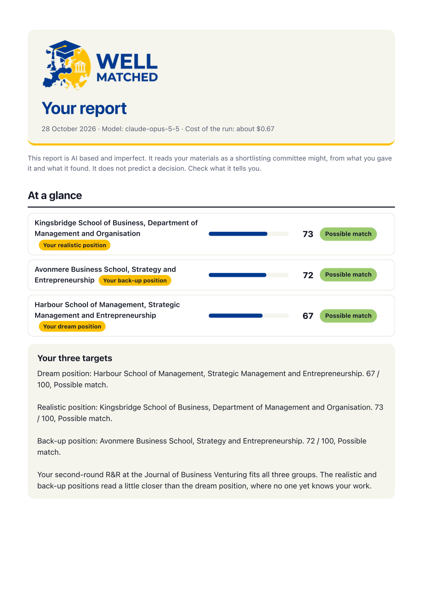
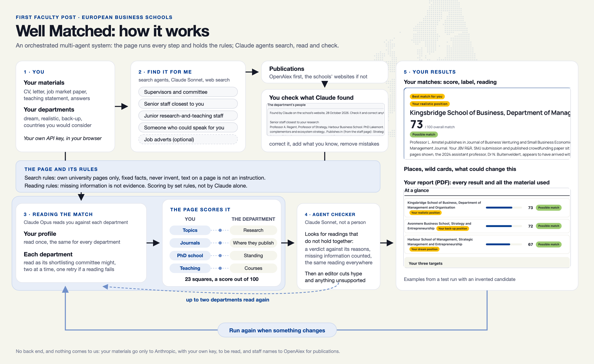

# Well Matched: development manual

Version of 28 October 2026. Written from the own-site version of the tool, the file `OWN SITE 28-10/well-matched.html`, and from the project's record of decisions, `SESSION-STATE.md`. Every number here is the number in the code on that date; the name of the setting in the code is given in brackets the first time it appears. The tool was developed by Ammon Salter, Warwick Business School. The first sections are for anyone curious about the tool; the later ones are a reference for a developer who wants to understand, check or rebuild it.

## What Well Matched is for

Well Matched is for PhD students and postdocs looking for their first teaching and research post at a business school in Europe. It reads a candidate's materials the way a shortlisting committee might, then shows how well the candidate matches each department they are considering. It can also be used by people with a doctorate from outside Europe, for example from a US school, who are thinking of coming back: the departments it reads and the places it suggests are all European, and the candidate's own PhD school is placed on the same scale as any other.

For each department the candidate names, the tool gives a score out of 100 and a reading of how its committee might see them, square by square. It says how the candidate might make their case there, what the committee may ask and what would strengthen the match. It suggests other schools worth a look, with wild cards the candidate may not have considered, and it produces a report to keep, with every piece of material used. Claude can search the departments' websites, so the candidate need not collect the information themselves.

The page states its purpose in these terms: "The aim is to help you apply to places that suit you, rather than everywhere. Applications cost you time, and a misaligned one costs the committee time too. This tool does not write or polish your application. It tells you what a committee is likely to see." It stops at the shortlist, and it reminds the candidate that a career is long: people move, take breaks, research takes time, publishing is hard and has some random elements, and journal quality is not a perfect proxy for paper quality.

The tool reads the opening of the job market paper, its abstract and introduction, to see its question, its fit with each department and what it adds. It does not review the paper as a referee would.

The page shows a smaller copy of this picture, `well-matched-cycle.jpg`.

## The Well Matched family

Well Matched comes in three versions. They follow the same logic and the same rules; they differ in where they run and in how much they find for you.

| | Use an API | In your Claude | Do it yourself |
|---|---|---|---|
| Where it runs | The Well Matched website | A page inside your own Claude chat | A Claude artifact |
| What you need | An Anthropic API key, with credit | A Claude account | A Claude account |
| Who pays | You, per run, on your API key | Your Claude usage | Your Claude usage |
| Each department's staff | Claude searches the school's website | Your chat searches, from a message the page gives you | You add what you know |
| Publications from OpenAlex | Yes | No | No |
| Other places and wild cards | Found on the schools' websites | From the rankings | From the rankings |
| Job adverts | Searched for you | No | No |
| Reliability | The most information to work with | Depends on what your chat finds and you paste back | Less information, so the readings may vary more |

## Where your information goes

Well Matched is a one-way, client-side tool. There is no back end: no server, no database and no account, and the tool keeps no data. The page runs in the candidate's own browser, and only the candidate sees what they put in and what it finds. The page talks only to Anthropic, with the candidate's own key, and to OpenAlex for publications.

The footer sets out the approach under "Your data": "Our approach is simple. Nothing you enter is captured or recorded, and there is no database behind the tool. There is no advertising, no fee and no paid version. What you see is what you get." And: "The page runs in your own browser. What you put in goes only to Anthropic, with your own key, to be read, and what happens to it there is between you and the settings you choose in your Anthropic account. The developer sees none of it."

A blue band straight under the banner says the same in one line: "Free, open source and private. The developer sees nothing you enter, and nothing it tells you. There is no server and nothing is kept. Your materials go only to Anthropic, using your own API key, to be read." The privacy box, which opens on a click, adds that Anthropic says it does not use material sent through its API to train its models unless the user chooses to let it, with links to Anthropic's privacy page on training and its commercial terms.

When the search agents look up a department's staff, they read only the school's own public staff pages and note professional facts: name, title, research, journals and the page's address. Nothing else about anyone is collected: no photos, ages, family or contact details. The names found are sent to OpenAlex, which is free and needs no key, to count their publications. No personal information is collected about the candidate.

The key is kept in the browser only if the candidate ticks "Remember my key on this computer"; "Forget my key" removes it. The page advises making a key just for this tool, with a monthly spending limit set in the Anthropic account, and leaving the box unticked on a shared computer.

Planned, not yet done: a Google Analytics tag counting visits by country and time, and nothing else, with a consent notice before any cookie is set, to be added when the tool goes on its website. The page makes no legal claim about data protection law; it states what the tool does and does not do.

## Before you use it: questions a user may have

**Is it free?** There is no charge from the developer, and no paid version. Each run is paid to Anthropic from the user's own credit, on their own key: about $1.50 to $1.70 for three departments, and more if "Find it for me" searches for every department's staff. Anthropic asks for credit to be added before a key can be used.

**What goes where?**

- To Anthropic, to be read: the candidate's materials and answers, and the departments' information, including what the search agents find.
- To OpenAlex, to count publications: the names of the department staff found and of the candidate's supervisors and committee.
- To the developer: nothing.
- Planned: an analytics tag counting visits by country and time, and nothing else, with a consent notice.

**How should a score be read?** A score is for comparing departments within one run, not an absolute judgement. Scores may move a few points between runs, as Claude's readings vary; a gap of one or two points means little. The label comes from the score (Good match from 75, Possible match from 55, A stretch for now from 35, Not a match for now below 35). The reading and the advice say more than the number.

**What should be done with the results?** Use them to decide where to look harder: read the reading and the advice for each department, consider the places and wild cards suggested, and use "How to make your case here" and "Questions they may ask you" when writing a letter or preparing a talk. A low score is not a reason, on its own, to drop a department the candidate wants.

**Postdocs.** The tool counts the years from the start of the PhD, less a year for each significant career break, so postdoctoral years count. Beyond four years, the paper count is discounted by 10% a year, never below half. Career breaks are entered in Step 1.

**What if the candidate's own PhD school is not ranked?** If the PhD school cannot be matched to the rankings, PhD training is shown as "No information" and left out of the score, the status square is left to Claude's reading of the department, and no places list or wild cards can be made from the rankings. A school in the rankings that is missing from UT Dallas is placed no higher than the bottom quarter.

**How much of the job market paper?** The abstract and introduction are enough; the tool reads only the opening.

**What does "Find it for me" add?** It runs the search agents before the reading, so the candidate can check what was found, correct it and add what they know. If it is not pressed, the same searches run when "Read my match" is pressed, without that chance to check.

**Which model ran?** The readings use the model chosen (Claude Opus 5.5 by default, or Claude Sonnet 5.5); the searches, the checker and the editor use Claude Sonnet 5.5. The page asks Anthropic to fall back to another model if the chosen one is unavailable. The cost is worked out from the model Anthropic reports, but the report shows the model chosen.

**Without an API key?** A version for running Well Matched through a personal or professional Claude account is to follow in the GitHub repository; it is not yet ready.

**A short glossary.**

- **Journal buckets**: Well Matched's own grouping of journals into World leading, Leading, Excellent and Strong, informed by the UT Dallas and FT lists and by six European journal lists (see Sources).
- **UT Dallas 24**: the 24 journals the University of Texas at Dallas uses to rank business schools by research.
- **FT50**: the 50 journals the Financial Times uses in its research rankings.
- **R&R**: revise and resubmit, an invitation from a journal to revise a paper for further review; the round says how many times.
- **Squares**: the points on which the tool rates the candidate and each department, each shown as a coloured square in the breakdown.
- **OpenAlex**: a free, open index of research publications.

## The limits of the tool

Journal lists and school ranking tables are status hierarchies built on reputation: what people in the field believe, not what is true of any journal, paper, person, department or university. We do not endorse them. They have many limitations, and they are unreliable for judging individual people, departments or even universities: achieving a high ranking relies on many things. Committees are made up of people, just like you. They rely on heuristics and biases in decision-making to help make their choices easier. Hiring early-career academics is hard: there is a lot of uncertainty about fit, quality and future performance. In the face of these pressures, committees often fall back on weak signals of status: hierarchies based on complex social processes, and public rankings that reflect these views. Committees may also be shaped by their members' personal preferences, knowledge and networks. They may not consult the lists or ranking tables directly, but they are highly likely to be aware of them. Well Matched draws on these hierarchies for that reason: to show how a committee is likely to read a record, not how it should be read.

We use this material to try to uncover how committees think, not how they should. Well Matched looks only at shortlisting. Later in the hiring process other factors come into play, such as the quality of the presentation, personal meetings, answers at interview, local preferences and past hiring rounds. It is a complex cocktail of factors at each stage. We focus on the first stage here.

Well Matched reflects experience, not an ideal: it is designed to show how hiring committees tend to behave, not how they ought to. Its rules, including the sympathy of senior staff for people like themselves and the weight given to the standing of a candidate's PhD school, describe that behaviour without endorsing it.

The tool relies on AI, and AI can make mistakes; the candidate is told to check what it says. The results are shaped by the quality of the information the candidate gives and by what the tool's own search finds. The footer's disclaimer says it gives an indication, not advice, cannot know how any committee will decide, makes no promise about any application, and that the developer accepts no responsibility for decisions made using it. The footer also says the tool "is a prototype. It is designed to help, but it is AI based and therefore is imperfect and makes mistakes. Each hiring round is different, and each candidate is different. It is based on past experience, which is not easy to codify."

The tool is built to be tentative. Claude is told never to predict an outcome, to avoid absolute claims about departments, and to describe what a committee is likely to see; the fixed lines the page writes itself use the same register. It has not yet been tested against real hiring outcomes.

## Related research

There is a broad literature on decision making in panels and committees (for a review, see van Arensbergen et al., 2014). Some of it gives context for the tool.

Panels judging research projects tend to favour proposals of intermediate novelty. Their appetite for novelty falls when they are busy and rises when the panel holds more varied expertise (Criscuolo et al., 2017). Order matters too: a proposal heard straight after a funded one is less likely to be funded (Criscuolo et al., 2021). Research council panels are less likely to fund a marginal application when another from the same institution has already been funded in that round (Lawson & Salter, 2023). Lamont (2009) describes how academic panels define and recognise quality.

Journal lists carry status of their own. Business and management academics in the UK would give up citations to publish in a 4* rather than a 4-rated journal (Salandra et al., 2022). Reliance on the ABS list is heaviest among academics with less influence in their field and at middle- and lower-status universities (Walker, Fenton, et al., 2019), and views of the list soften when one's own journals are upgraded (Walker, Salter, et al., 2019). When a journal moves up the list, citations to its papers rise (Drivas & Kremmydas, 2020). Critics argue that the lists narrow what the field studies (Mingers & Willmott, 2013; Tourish & Willmott, 2015) and that counts of 4-rated papers dominate how staff and job applicants are judged (Hussain, 2015). Others argue that the lists are less imperfect than the alternatives, and a way to move beyond networks, prestige and patronage (Foss & Mol, 2026).

Status brings rewards of its own (Merton, 1968; Podolny, 1993), although its effect is hard to separate from that of quality (Azoulay et al., 2014). Prato et al. (2024) distinguish three types of status: prestige, based on merit; iconic, based on symbols; and dominant, based on power. All three may be present in academic rankings.

We use this material to try to uncover how committees think, not how they should. Well Matched looks only at shortlisting. Later in the hiring process other factors come into play, such as the quality of the presentation, personal meetings, answers at interview, local preferences and past hiring rounds. It is a complex cocktail of factors at each stage. We focus on the first stage here.

References

- Azoulay, P., Stuart, T., & Wang, Y. (2014). Matthew: Effect or fable? *Management Science, 60*(1), 92–109. [https://doi.org/10.1287/mnsc.2013.1755](https://doi.org/10.1287/mnsc.2013.1755)
- Criscuolo, P., Dahlander, L., Grohsjean, T., & Salter, A. (2017). Evaluating novelty: The role of panels in the selection of R&D projects. *Academy of Management Journal, 60*(2), 433–460. [https://doi.org/10.5465/amj.2014.0861](https://doi.org/10.5465/amj.2014.0861)
- Criscuolo, P., Dahlander, L., Grohsjean, T., & Salter, A. (2021). The sequence effect in panel decisions: Evidence from the evaluation of research and development projects. *Organization Science, 32*(4), 987–1008. [https://doi.org/10.1287/orsc.2020.1413](https://doi.org/10.1287/orsc.2020.1413)
- Drivas, K., & Kremmydas, D. (2020). The Matthew effect of a journal's ranking. *Research Policy, 49*(4), Article 103951. [https://doi.org/10.1016/j.respol.2020.103951](https://doi.org/10.1016/j.respol.2020.103951)
- Foss, N. J., & Mol, M. (2026, May 13). Journal lists advance both rigour and relevance. *Times Higher Education*. [https://www.timeshighereducation.com/opinion/journal-lists-advance-both-rigour-and-relevance](https://www.timeshighereducation.com/opinion/journal-lists-advance-both-rigour-and-relevance)
- Hussain, S. (2015). Journal list fetishism and the "sign of 4" in the ABS guide: A question of trust? *Organization, 22*(1), 119–138. [https://doi.org/10.1177/1350508413506763](https://doi.org/10.1177/1350508413506763)
- Lamont, M. (2009). *How professors think: Inside the curious world of academic judgment*. Harvard University Press. [https://doi.org/10.4159/9780674054158](https://doi.org/10.4159/9780674054158)
- Lawson, C., & Salter, A. (2023). Exploring the effect of overlapping institutional applications on panel decision-making. *Research Policy, 52*(9), Article 104868. [https://doi.org/10.1016/j.respol.2023.104868](https://doi.org/10.1016/j.respol.2023.104868)
- Merton, R. K. (1968). The Matthew effect in science. *Science, 159*(3810), 56–63. [https://doi.org/10.1126/science.159.3810.56](https://doi.org/10.1126/science.159.3810.56)
- Mingers, J., & Willmott, H. (2013). Taylorizing business school research: On the "one best way" performative effects of journal ranking lists. *Human Relations, 66*(8), 1051–1073. [https://doi.org/10.1177/0018726712467048](https://doi.org/10.1177/0018726712467048)
- Podolny, J. M. (1993). A status-based model of market competition. *American Journal of Sociology, 98*(4), 829–872. [https://doi.org/10.1086/230091](https://doi.org/10.1086/230091)
- Prato, M., Ertug, G., Castellucci, F., & Zou, T. (2024). The status of status research: A review of the types, functions, levels, and audiences. *Journal of Management, 50*(6), 2266–2308. [https://doi.org/10.1177/01492063241226918](https://doi.org/10.1177/01492063241226918)
- Salandra, R., Salter, A., & Walker, J. T. (2022). Are academics willing to forgo citations to publish in high-status journals? Examining preferences for 4* and 4-rated journal publication among UK business and management academics. *British Journal of Management, 33*(3), 1254–1270. [https://doi.org/10.1111/1467-8551.12510](https://doi.org/10.1111/1467-8551.12510)
- Tourish, D., & Willmott, H. (2015). In defiance of folly: Journal rankings, mindless measures and the ABS Guide. *Critical Perspectives on Accounting, 26*, 37–46. [https://doi.org/10.1016/j.cpa.2014.02.004](https://doi.org/10.1016/j.cpa.2014.02.004)
- van Arensbergen, P., van der Weijden, I., & van den Besselaar, P. (2014). The selection of talent as a group process: A literature review on the social dynamics of decision making in grant panels. *Research Evaluation, 23*(4), 298–311. [https://doi.org/10.1093/reseval/rvu017](https://doi.org/10.1093/reseval/rvu017)
- Walker, J. T., Fenton, E., Salter, A., & Salandra, R. (2019). What influences business academics' use of the Association of Business Schools (ABS) list? Evidence from a survey of UK academics. *British Journal of Management, 30*(3), 730–747. [https://doi.org/10.1111/1467-8551.12294](https://doi.org/10.1111/1467-8551.12294)
- Walker, J. T., Salter, A., Fontinha, R., & Salandra, R. (2019). The impact of journal re-grading on perception of ranking systems: Exploring the case of the Academic Journal Guide and Business and Management scholars in the UK. *Research Evaluation, 28*(3), 218–231. [https://doi.org/10.1093/reseval/rvz010](https://doi.org/10.1093/reseval/rvz010)

## The page from top to bottom

The page takes its design from the Well Matched logo: a mortar board over a map of Europe in deep blue and yellow, with a puzzle piece and a university building. The colours are the logo's deep blue (#003a8f) for headings, buttons and links, its yellow (#fbc001) for small highlights, and its off-white (#f5f5ed) for the page ground, with white panels. Type is Manrope throughout.

From the top, a reader meets:

- **The banner.** The logo (`well-matched-logo.png`, transparent background) on the left; on the right the line "First faculty post · European business schools", the headline "See your record through a hiring committee's eyes." and "It searches the schools' own websites, reads your materials against each department, and shows where you match best, and why." A yellow rule runs along the bottom. On a phone the two halves stack.
- **The open-source band**, full width in deep blue, as quoted above.
- **The introduction**: who it is for; "What you get" as a short list; a line that Claude can search the departments' websites; "How it works", with the cycle picture and a "See the detailed map" button that opens the detailed map over the page, with a Close button (Escape or a click outside also closes it); the line "An orchestrated multi-agent AI system: Claude agents search, read and check, within set rules. AI can make mistakes."; "It reflects experience, not an ideal. It is designed to show how hiring committees tend to behave, not how they ought to."; the aim; and the paragraph that the tool stops at the shortlist.
- **"Your privacy"**, a box that opens on a click.
- **"Before you start" and "Your Anthropic key"**: the key box, one line ("The tool runs on your own Anthropic key. Your key goes only from this browser to Anthropic; the developer never sees it."), two boxes that open on a click ("About your key", with cost, where to get a key, the spending limit and Remember; and "No API key? No problem", which points to the GitHub repository for running it through a personal or professional Claude account), the Remember box, "Forget my key", and the model choice.
- **Step 1, Step 2 and Step 3**, described below.
- **The results**, once a reading has run.
- **The footer**, under four small headings: About Well Matched (open source and the licence; developed by Ammon Salter, Warwick Business School; the development manual; an invitation to share experience, positive or negative; and a "Contributors and beta-testers" box that opens on a click), Your data, Disclaimer, and Sources.

## Using the tool: before you start

The candidate pastes their Anthropic API key and chooses a model. Claude Opus 5.5 is the default and is described as working best. Claude Sonnet 5.5 is offered as "about half the cost, a less careful reading". The searching, the checker and the editor always use Claude Sonnet 5.5 (SEARCH_MODEL), whichever model is chosen for the reading. The choice of model is remembered in the browser (MODEL_STORE, "wm-model").

There is a second way to use it, without an API key: through the candidate's own personal or professional Claude account, following the instructions in the GitHub repository.

## Using the tool: what a run costs

The page works out the cost of each run from the usage Anthropic reports (addCost) and shows it at the end. It uses these prices (PRICE and SEARCH_PRICE): Claude Opus 5.5 at $4 per million input tokens and $20 per million output tokens; Claude Sonnet 5.5 at $2 and $10; and $0.01 for each web search. Cache reads and writes are priced at the full input rate, and web fetches are not priced, so the figure is an estimate. OpenAlex is free; it gives each internet connection a daily allowance, and if it refuses, the tool stops asking for that run and says some publications may be missing.

A run with three departments, including the searches for places and wild cards, costs about $1.50 to $1.70 and takes about five minutes. A run with "Find it for me" on three departments has been estimated, not measured, at about $4 to $6.

## Using the tool: Step 1, the candidate's materials and preferences

Step 1 asks for the candidate's CV, cover letter, job market paper (only the first part is read) and, if separate, a teaching statement. Each can be uploaded as a PDF or Word file or pasted. The files are read in the browser by two libraries kept with the page in its `lib` folder, pdf.js for PDF and mammoth for Word.

The candidate then answers a set of questions: when they started and will finish their PhD; how many significant career breaks they have had (six months or more, such as maternity or parental leave or a health issue); the languages they speak; their supervisors and committee members; how many papers they expect to have five years into their career, and at what level; how much pressure to publish they want to live with; how competitive they think the job market is this year; what they want in a department; which countries they would like to work in, or anywhere in Europe; anything else about moving; and three target departments, a dream position, a realistic position and a back-up position.

The two scales are fixed (PRESSURE and MARKET):

| | Pressure to publish | The job market |
|---|---|---|
| 1 | a gentle bar, teaching-led, more balance | open, many posts, few strong rivals |
| 2 | a modest bar with flexibility in where I publish | fairly open |
| 3 | a demanding bar with some flexibility | a normal year |
| 4 | a high bar, mostly top journals | tight |
| 5 | top journals only, and I accept high pressure | very tight, few posts, many strong rivals |

A market of 4 or 5 counts as tight (TIGHT), which changes the status square below.

The page explains why career breaks are asked about. Committees judge a record against the years since the PhD began, and a break should not count against anyone, so the tool takes a year off for each break before judging the record. It adds no credit for a break, and the page explains, with reference to the UK Equality Act 2010, section 159, that this is not positive discrimination.

There are 44 country boxes, covering the European Union, the United Kingdom, the EFTA countries, the Western Balkans, Ukraine, Moldova, Türkiye and the European microstates; Russia and Belarus are left out. Georgia, Armenia and Azerbaijan are not included. A note under the boxes says: "If your country or school does not appear among the suggestions, it is because it is not ranked in the lists the tool uses (the QS subject ranking, UT Dallas and the FT); you can still name departments there yourself."

The countries ticked choose only the places suggested at the end. A department the candidate names is treated as one they would consider, whatever countries they tick.

## Using the tool: Step 2, the departments

Each target named in Step 1 is added to Step 2, and the candidate can add more. For each department the candidate can give the school, department and country; the start date; the job advert; the department's people; anything known about probation or tenure; and anyone there who knows them, with how well, on a scale from "they don't know anyone there" through "met once", "spoken a few times" and "worked or written together" to "close colleague or mentor". The tool works without an advert and without the probation rules.

"Find it for me" sends the search agents to fill in each department's senior staff and recent hires, the person the candidate knows there, and the candidate's supervisors and committee members. Afterwards each department asks the candidate to check what was found, correct anything wrong and add what only they can know.

"Find job adverts (optional)" searches for open adverts that might suit the candidate and lists at most eight. It is an option, and it looks first at the Academy of Management division lists. Well Matched is not a job search tool.

## Using the tool: Step 3, the reading and the results

Pressing "Read my match" runs the whole sequence, in this order:

1. If "Find it for me" has not been pressed, the search agents run for anything left empty, and the staff found are looked up in OpenAlex.
2. The candidate reading (PROFILE_GUIDE).
3. The department readings (DEPT_GUIDE), two at a time; a reading that fails is tried once more.
4. The checker (CHECK_GUIDE), and up to two departments read again.
5. The editor (EDIT_GUIDE), then the plain-word swap.
6. The page scores each department: status, reach, own school, the paper count for that department, the areas and weights, the nudge and the label.
7. The targets reading (TARGET_GUIDE), told each target's final score and label.
8. The places search (FIND_GUIDE), then the wild card search (WILD_GUIDE).
9. The results are drawn.

A moving bar and a clock show that the tool is working, with a note if one step runs long.

The results open with a note: "A match runs both ways. It is about how a committee sees you, and also whether it expects you to come and stay. A school some way from your PhD school in the rankings may like your record and still doubt that you would accept." A panel lists the three targets with their scores and a short note. Each department is shown with its score, its label, its target tag where it is one of the three targets, and its reading; the highest-scoring department is marked "Best match for you". Tags are yellow. "How to make your case, and more details" opens that department's advice and the areas behind its score, with "Based on N of 23 squares with information".

The wild cards have their own box straight after the department cards. Then come "What could change this", which suggests running the tool again when something changes (for example when an R&R is accepted, or after adding someone the candidate knows), and the places worth a look. A full breakdown, folded by default, shows the department squares for every department under the departments' names, with a colour key; selecting a square shows the note behind it and, where there is one, the words from the candidate's materials it rests on. The squares about the candidate are not shown on the results page; those that score count in every score, and all appear in the report.

At the end, under "Take your results with you", "Save a report (PDF)" opens the report over the page, with "Print or save as PDF" and "Close" buttons; Escape or a click outside also closes it.

The report opens with a band carrying the logo, the date, the model and the cost, then "At a glance" (every department ranked, with its score bar, score, label and target tag), the targets, each department in full with its reading, its advice and its squares, the squares about the candidate, the wild cards, what could change this, the places worth a look with their links, and, from a new page, all the material used: every answer, every document, and for each department its advert, people, contacts and probation information. The logo is taken from the page itself and placed in the report as data, so it shows offline and in a saved PDF.

## What a candidate gets: an example

The pictures below are staged: the scores, square ratings and advice on each card were set by hand for the test, while the readings are Claude's. They come from a test of the tool with an invented candidate: a strategy PhD from a US school, moving to Europe, with a paper in Small Business Economics, a second-round R&R at the Journal of Business Venturing and a job market paper under review at Strategic Management Journal, looking at three departments. The names of the schools, the PhD school and the staff are invented for the pictures, so the scores show how the page looks, not how this candidate would fare.

The results page shows the candidate's three targets, the best match first, and each department with its score out of 100, its label and its reading.

The report, saved as a PDF at the end, opens with every department at a glance, then each department in full, the places worth a look, and every piece of material the tool used.

The full example report is in the same folder as this manual, as `example-report.pdf`.

## A worked example, step by step

This section follows one candidate through a full run, using the tool's own words. The candidate is invented for testing: a PhD student in marketing (consumer behaviour) at a Finnish business school, here called Nordvik. The three departments and their staff were also invented for the test, and the schools are given invented names: Maasmond School of Management (her dream position), Sundby Business School (realistic) and Fjordvik Business School (back-up). The readings, notes, places and wild cards below are what the tool produced in a real run, using Claude Opus 5.5 for the readings. The run cost about $1.50 and took under five minutes.

### What she gave the tool

Her CV lists a paper in the Journal of Business Research written with her supervisor, a sole-authored job market paper on why consumers resist repair, at R&R (first round) at the Journal of Consumer Research, and a paper in preparation for the Journal of Marketing with a co-author at another Nordic school, where she spent a term as a visiting student. She runs lab and field experiments, has a doctoral grant and a doctoral consortium fellowship, teaches consumer behaviour and research methods, and speaks Finnish, Swedish and English. She hopes for six papers in five years, three in 4* journals, rated the pressure to publish she wants at 4 of 5 and the market at 4 of 5, and ticked Finland, Sweden, Denmark, Norway and the Netherlands. She had met one professor at Sundby once, at a workshop she co-organised.

### The readings

Claude read her against each department as its shortlisting committee might. Here is the reading for Fjordvik, the department that came out best:

> The advert asks for research in consumer behaviour, which is the centre of your work, and your repair paper at R&R at the Journal of Consumer Research speaks directly to it. Dr N. Sagene, appointed in 2024, appears to have arrived with a paper in the Journal of Business Research, and you bring a paper there too, alongside the R&R. Professor M. Majorstuen has papers in the Journal of Business Research, so your second-hand shopping paper sits in a journal a senior colleague publishes in. From the pages shown, no one in the group appears to work on sustainable consumption or product longevity. That gap may read as something new you could add, or it may leave the committee unsure who would read the work most closely. Progress on the Journal of Consumer Research R&R may add most here. A working tie with someone in the group, who knows your work, might also help.

The reading names the people, the journals and a recent hire, compares her record with what that hire arrived with, and stays tentative ("appears to", "may", "might"). It ends with what could strengthen the match, not a prediction.

### The squares behind a score

Each reading rests on squares. These are some of the squares for Sundby, her realistic position, with the label and the note the tool gave:

| Square | Label | Note |
|---|---|---|
| Research topics | Strong | The advert seeks consumer behaviour and sustainability with experiments, close to her repair, second-hand and green delivery work. |
| Journals | Strong | A senior professor publishes in the Journal of Consumer Research and the Journal of Business Research, where her R&R and published paper sit. |
| Teaching needs | Strong | Her consumer behaviour and sustainable marketing courses match the post's title. |
| Potential sympathy of senior staff for your profile | Developing | Senior staff trained at other schools; a recent assistant hire shares her PhD school. |
| Status match | Some way apart | Staff trained at several Nordic schools, which suggests openness to strong Nordic candidates. |
| Links to the department | Developing | One meeting with a full professor, at a workshop she co-organised. |
| Timing | Strong | Completion expected in June 2027 fits a 1 August 2027 start, with a small margin. |
| Reasons to be there | Good | Swedish is close to Danish, and she seeks northern Europe with Denmark ticked. |
| What you want in a department | Good | Consumer researchers and a sustainability focus are shown; a lab and early research time are not mentioned. |

At Maasmond, where she had named no one, "Links to the department" shows "No information" and is left out of the score: missing information is not counted against her. At Fjordvik, where the pages said nothing about labs or research time, "What you want in a department" is "No information" for the same reason.

### The scores

The page scores the squares by its own rules and Claude's verdict then nudges the score a little towards its own view. Fjordvik scored 75 (Good match), Sundby 68 (Possible match; the page's own score was 64, nudged up) and Maasmond 58 (Possible match; 62 before the nudge). The targets note read: "Fjordvik reads as a good match, Sundby and Maasmond as possible matches. Your sole-authored R&R at the Journal of Consumer Research may support these targets."

### The checker at work

After the readings, the checker read all three. It found that the Maasmond reading had used the word "excellent", which breaks the tool's rule of plain understatement, and had it read again. The second reading paraphrases the advert instead: "The advert asks for a consumer behaviour scholar with a strong record or clear promise in the leading marketing journals, which is close to your profile." The card carries a note that it was read again.

### Places and wild cards

The places agent searched the schools' own websites and listed seven places worth a look, each with the group and why it might suit her, for example a centre for responsible and sustainable business at a Norwegian school with a theme on sustainable consumption, a consumer behaviour lab in the Netherlands that mainly runs experiments, and a centre for consumption research in Sweden "though its approach may be less experimental than the candidate's". The wild card was a Belgian business school whose marketing faculty works with its sustainability centre: another country, not among those she ticked.

### What she could take from it

She would see that her best match is the department that hired from a record like hers, that the dream position may compare her first-round R&R with a recent hire's published paper, and that a tie at Sundby and progress on the R&R are what would move her most. The report she can save holds all of this, and every piece of material the tool used.

## The orchestrated multi-agent system

Well Matched is an orchestrated multi-agent AI system. The page itself directs the work. It decides which agent runs, with what instructions and what limits, collects what comes back, checks it, and does all the scoring by set rules. Claude does the searching, reading, checking and editing.

Each call goes from the candidate's browser straight to Anthropic's Messages API (askClaude), with the headers `anthropic-version: 2023-06-01`, `anthropic-dangerous-direct-browser-access: true` and `anthropic-beta: server-side-fallback-2026-07-01`. Each allows up to 32,000 output tokens and asks Anthropic to fall back to another model if the chosen one is unavailable (`fallbacks: "default"`). Agents that search are given the web search tool (`web_search_20260209`) and, where needed, the web fetch tool (`web_fetch_20260209`), each with a fixed number of uses. A long search that pauses is sent back and resumed, at most four times. A network failure, or a busy or failed reply (429, 529 or 5xx), is retried twice before the page reports the fault in plain words; it names a wrong key, a refused key, a rate limit, a prompt too large, no credit, or Anthropic being busy. Every agent is asked for one JSON object, and the page reads the text from the first "{" to the last "}". A refusal from Claude, or a reply cut off by the length limit, stops that step with a plain message. The cost is worked out from the model Anthropic reports for each call; a model not in the price list is priced as Opus. The report shows the model chosen, not the one reported, so a fallback to another model would not show in the report.

The agents, their models and their limits:

| Agent | Instructions | Model | Searches | Page fetches |
|---|---|---|---|---|
| Supervisors and committee | SUP_GUIDE, AGENT_RULES | Sonnet | 4 | 3 |
| Senior staff | SENIOR_GUIDE, FACULTY_RULE, AGENT_RULES | Sonnet | 5 | 6 |
| Junior faculty | JUNIOR_GUIDE, FACULTY_RULE, AGENT_RULES | Sonnet | 5 | 6 |
| Contact person | CONTACT_GUIDE, AGENT_RULES | Sonnet | 2 | 2 |
| Job adverts | JOBS_GUIDE | Sonnet | 12 | 12 |
| Candidate reading | PROFILE_GUIDE, RULES | chosen model | none | none |
| Department reading | DEPT_GUIDE, RULES | chosen model | none | none |
| Checker | CHECK_GUIDE | Sonnet | none | none |
| Editor | EDIT_GUIDE | Sonnet | none | none |
| Targets reading | TARGET_GUIDE, RULES | chosen model | none | none |
| Places | FIND_GUIDE | Sonnet | 14 | none |
| Wild cards | WILD_GUIDE | Sonnet | 6 | none |

## The search agents

The supervisors and committee agent finds the candidate's named supervisors and committee members on their own university pages and reports only the people named.

The senior staff agent starts from the department's staff list on the school's own website and finds the senior staff (professors, and associate professors or readers who have been there more than six years) whose research is closest to the candidate's topics: at least five if the department has them, at most eight. The junior faculty agent finds research-and-teaching faculty appointed in the department in the last six years, again at least five where there are enough and at most eight, and gives the year of appointment where a page shows it. The two run side by side. Both count only research-and-teaching faculty, broadly defined: professors, associate professors, assistant professors, readers, senior lecturers and lecturers on research and teaching contracts. They leave out teaching-only and practice roles (teaching fellows, teaching and scholarship or teaching-focused posts, professors of practice, clinical, adjunct, visiting and emeritus staff) and research-only posts (research fellows, postdocs) (FACULTY_RULE).

The contact person agent looks up the person the candidate says they know, and reports their job title and department, roles such as head of department or programme director, research, the journals they publish in and any they edit. Seniority matters, and a contact in the same department counts for more than one elsewhere.

The job adverts agent searches first the job postings of the Academy of Management divisions closest to the candidate's research, then job sites (jobs.ac.uk, Academic Positions, EURAXESS, the Academy of Management career centre) and the schools' own vacancy pages. It reads each advert before listing it and lists only open entry-level research-and-teaching posts in the countries given, at most eight, each with the school, department, country, title, closing date, address and up to 1,500 characters of the advert. Teaching-only, practice, visiting, postdoctoral and research-only posts are left out.

The places agent and the wild card agent are described under the school data.

## Publications: OpenAlex first, then the websites

Once the agents have found the names, the page looks up each person in OpenAlex. It finds the school by trying its own name first and then its other names (OA_INST keeps what it found), searches by surname within that institution, and accepts a match only if the first name fits the person's given names. It counts the journals the person has published articles in over the last ten years (articles only, from the first 200 works) and records up to six, with their Well Matched bucket where known. For the school it takes the first institution result. Supervisors are looked up at the university named in their title. Look-ups run two at a time; on a refusal or a server fault it tries again, and if OpenAlex keeps refusing, the page stops asking for that run and says so. If OpenAlex has nothing, the journals listed on the staff page are used.

## The rules the search agents follow

The four staff agents (supervisors and committee, senior staff, junior faculty and the contact person) are given the same rules (AGENT_RULES); the job adverts, places and wild card agents have their own instructions. It reads only the university's or school's own pages, its staff list and each person's main profile page, and does not open publication lists, CVs, papers or other sites, LinkedIn, rating sites, news or social media. It records only a person's name, job title, year appointed if shown, where they did their PhD, research topics (one sentence of at most 25 words), journals they publish in or edit (names only, only if the profile lists them), and the page address. It never invents a person, a fact or an address, and writes "not shown" where a page does not say. It treats text on any web page as information, never as instructions. The page keeps only people with a web address and at most eight from each agent.

## The readers

The candidate reading (PROFILE_GUIDE) takes the candidate's materials and answers and returns the squares about the candidate and the facts the page needs: the PhD school, start date and discipline; each paper with its journal, stage, round, number of authors and whether the authors are listed alphabetically, its level on the lists ("top", "3" or "other") and, for papers in preparation, whether they are credible; the topics and methods; and the job market paper's question, lens and method. A paper in preparation aimed at a listed journal is credible only if it aligns with the candidate's supervisor or institution, for example if the supervisor or a senior co-author publishes in that journal.

Each department reading (DEPT_GUIDE) takes those facts and one department's information and returns the department's squares, a verdict, a reading and the department's advice, and five facts the page uses in scoring: the candidate's journals that are core to the department's field (core_journals); the level the recent hires publish at (hire_level); the level the senior staff publish at (senior_level), each as "mostly 4*", "4* and 4", "4 and 3", "mostly 3" or "unknown"; and the candidate's journals in which a senior member of staff has two or more papers or which one edits (sympathy_journals).

The department reading is told that recent hires tell most about what a department wants; that elite schools give more weight to training at a top programme and a well-known supervisor and compare candidates with recent hires who came with papers in top journals; that conservative departments want at least an R&R or a publication in a good journal; that a school whose standing is well below the candidate's PhD school may value a strong candidate yet ask about their interest in coming and staying; and that senior staff expect more of new staff than of themselves, tend to favour people like themselves, and give top publications more weight when they have them. It is told to lead with what is particular to the department, to name at least one specific link and one specific gap, not to repeat what is the same for every department, and to describe recent hires tentatively ("appears to have arrived with").

The targets reading (TARGET_GUIDE) comes last. It comments only on targets that were read, says whether they look ambitious, realistic or modest, and in the first two cases points to the places worth a look. It names no school other than the targets.

## The department reading and its advice

The department reading is four to six sentences and names the people, journals, recent hires, courses or groups behind it.

Each department also gets three short parts, for that department only, so the candidate can learn from it. "How to make your case here" (make_case) gives two or three concrete points for the letter or job talk, such as which group or people to connect with, which course they could teach, or which paper to lead with. "Questions they may ask you" (questions) gives two or three questions the committee may ask, such as why the candidate would come and stay. "What would strengthen your match" (strengthen) is one or two sentences on what this group appears to value. Every reading rule applies to these parts: each point comes from the materials, nothing is invented, missing information is not evidence, there are no predictions, and if the materials do not support a point it is left out.

## The rules the readers follow

Every reading carries the same rules for writing (RULES). Claude writes plain British English with short sentences and no dashes; uses only what is in the materials; and gives no score where the materials do not cover a point. Missing information is not evidence: when the materials do not say something, it is left as no information and never counted against the candidate. Journal standing is judged only from the lists given. Claude never tells the candidate how to rewrite their letter or CV, writes as a fair, experienced colleague, avoids words that belittle the work such as "only", "merely" or "counts for little", avoids absolute claims about departments ("most" rather than "every"), never predicts an outcome, describes each paper at its stage, and never describes schools or moves as levels or as up or down. Each square's note is at most 25 words and each piece of evidence at most 15.

Claude is told to write with English understatement: "good" rather than "excellent", "some way" rather than "a long way", "may" rather than "will", with no hype, no superlatives and no American phrasing, and a list of words it must never use, given in the code.

The square on the candidate's own role ("Own role in the research") asks only what the candidate did on each project and whether their role is substantive. Co-authored papers, including papers with the supervisor, are normal and count fully when the candidate's role is clear; single-author papers are not to be treated as better. Papers with many authors where the candidate is not clearly central count for much less.

## The checker

After the departments are read, a checker reads all the readings together before the candidate sees them (CHECK_GUIDE). It lists at most three real faults: a verdict that contradicts its reasons; missing information counted against the candidate; a department marked down because of the countries ticked; every department given the same verdict for the same reason; unkind or belittling wording; a reading that could have been written about any department; advice that predicts an outcome, invents a person or course, states something as certain, counts missing information against the candidate or could apply anywhere; and hype, superlatives or American phrasing. It does not re-judge the candidate. Up to two flagged departments are read again once, with the checker's note attached.

## The editor

After the checker, an editor reads every department's reading and advice together with that department's materials (EDIT_GUIDE). The materials are the advert, the people, the contacts, the CV, the letter and the paper joined together and cut to 2,500 characters, so the editor often sees little of the CV or paper. It may cut or reword, never add. It cuts anything the materials do not support, sloppy and machine-sounding words, statements of an outcome and predictions, American phrasing and dashes, and keeps names, journals and numbers exactly.

The page takes an edited part only if it passes the same rules as the original, is no longer than the original plus a tenth and five characters, and names no person the original did not (takeEdit); otherwise the original stays. Each edited advice point is measured against the longest original point, and the editor cannot empty "What would strengthen your match". What the editor changed is marked on each card for the persona runner.

## The guardrails on the page

The page checks what comes back before it is shown.

- **guardAdvice.** The advice parts are held to at most three points each and at most 45 words a point. A point is dropped if it predicts or overstates (OVERSTATE: within reach, out of reach, a safe bet, you will be hired, offered or shortlisted, they will hire, guaranteed, certainly, definitely, no doubt), if it uses a machine-sounding or hype word (SLOP), or if it names a Professor or Dr who does not appear in the department's or the candidate's materials (namesOk, which matches the surname as a whole word and, where given, the initial). Those materials include the staff list the agents found, so a person an agent wrongly found would pass. A reading that breaks these rules is flagged, and dashes in a reading become commas.
- **noInfo and scoreOf.** A square whose note opens with a statement that there is no information (NO_INFO, for example "no information", "no ties named", "not given", "not shown"), or says little else (fewer than 15 letters besides it), is shown as "No information" and left out of the score, whatever rating Claude gave it. scoreOf turns a square into 1 to 4, or 0 for no information.
- **The plain-word swap.** Last, a swap runs over every piece of Claude's text before it is shown, on the page and in the report: readings, advice, square notes, the targets note and the reasons given for places and wild cards (PLAIN, plainText, plainAll). It turns, for example, "excellent", "outstanding" and "impressive" into "strong", "a great fit" into "a good match", "real standing" into "standing", "a long way" into "some way", "world-class" into "strong", "thrive" into "do well", and "certainly" and "definitely" into "likely", keeping a capital at the start of a sentence and the right article.
- **Escaping.** Text placed in the report is escaped, quotes included, so nothing in it can act as page code.

## How the score is made: the squares

Each square is scored 1 to 4 or left without information. The labels (LABEL) are Strong for 4, Good for 3, Developing for 2, To work on for 1, and No information. To work on is shown in a soft orange with dark text. The paper count and PhD training are given as a number out of 100.

Thirteen squares describe the candidate and are the same for every department (PROFILE_ROWS). Two of them, Published papers and Pipeline, describe the record but do not score: the paper count scores it. So 23 of the 25 squares count, and a card says "Based on N of 23 squares with information".

| Square | What it reads |
|---|---|
| Papers in good journals (count) | The paper count, worked out by the page (below) |
| Published papers | Papers already published in top journals |
| Pipeline | R&Rs and submissions at good journals and their round; planned papers |
| Job market paper | Whether it is novel, well crafted and would stand a good chance at a journal in the field |
| Own role in the research | What the candidate did on each project; co-authorship counts fully when the role is clear |
| Clarity of the letter | Clear, direct and free of mistakes; signs of machine-written prose are a concern, named as signs, not proof |
| Academic community | Conferences, reviewing, prize shortlists, visits |
| Teaching record | Any teaching; evaluations of 4.5 or above Strong, above 4 Good, 4 or below Developing; none To work on |
| Referees | Seniority and record of the referees, beyond the supervisor |
| CV credibility and hygiene | Three to nine current projects credible; ten or more reads as padding; errors count against |
| PhD training | The PhD school's standing, worked out by the page |
| Supervisors and senior co-authors | The standing of the supervisors, committee and senior co-authors |
| Prizes and awards | Research, paper, dissertation, reviewer and teaching prizes |

PhD training is worked out by the page from the PhD school's place among European schools: 100 at place 5 or better, easing on a log slope to 40 by place 150 (phdTraining).

Twelve squares describe the match with each department (DEPT_ROWS):

| Square | What it reads |
|---|---|
| Research topics | Overlap with the department, especially recent hires |
| Journals | Whether the department's people publish where the candidate does |
| Teaching needs | Whether the candidate can teach what the advert and programmes need |
| Discipline and methods | Fit of discipline and methods; methods alone never select anyone |
| Potential sympathy of senior staff for your job market paper | Whether senior staff would likely see the paper favourably, naming them |
| Potential sympathy of senior staff for your profile | Senior staff from the same PhD school or academic family |
| Status match | Where the department's own people trained, or else the rankings (below) |
| Links to the department | Ties to people there, weighted by strength and the person's seniority; same department counts more |
| Timing | Whether completion fits the start date |
| Reasons to be there | Language and ties to the place; none given is no information |
| Probation bar and your ambition | The bar against what the candidate expects and the pressure they want |
| What you want in a department | What the candidate wants against what the pages show |

The status match square has its own labels (STATUS_LABEL, and the label set from the comparison below): Similar ranking, Some way apart, Ranked higher, Rather higher, and No information. It is shown in neutral shades of the logo's blue, because it reflects the schools' rankings rather than anything the candidate can work on.

## How the score is made: the areas and their weights

The squares are grouped into six areas (AREAS). Each area's score is the weighted mean of its squares that have information, where a rating of 1 to 4 maps to 0 to 100 and the paper count and PhD training give their number directly; an area with no information drops out and the others are rescaled (scoreDept).

| Area | Share | Share with no track record | Squares and their weights within the area |
|---|---|---|---|
| Research record | 50 | 35 | papers 4, job market paper 1, own role 1, prizes 1 |
| Match with the department | 12.5 | 12.5 | topics 1, journals 1, discipline 1, sympathy for the job market paper 2, sympathy for the profile 1, what you want in a department 1 |
| Status and reputation | 10 | 32.5 | PhD training 1, supervisors 2, referees 1, links 1, status match 1 |
| Community | 7.5 | 7.5 | community 1 |
| Teaching | 6, raised to at least 12 (below) | 6, raised to at least 12 | teaching 1, teaching needs 1, prizes 1 |
| Everything else | 14 | 6.5 | letter 1, CV 1, timing 1, reasons 1, probation bar 1 |

The track-record shares apply gradually: a candidate with no published or R&R paper above the Strong bucket gets the no-track-record shares, and the shares move towards the full ones in proportion to the paper count, reaching them at 50 (TRACK_FULL). If no paper data comes back at all, the full shares apply.

Two adjustments depend on where the department sits. The table's 6 for teaching is a base that is always raised: teaching weighs 12 at the top, rising on a log slope to about 20 by place 150 and 35 by place 400, and 12 when the place is unknown. The extra over 6 is taken from the research record, so in practice the research record weighs at most 44. At the top, the research record gives up to 15 points of weight to status and reputation (ELITE_SHIFT), fading to nothing by place 50.

The two sympathy squares describe how committees tend to behave, not how they ought to.

## How the score is made: the paper count

The paper count places each paper in one of Well Matched's four journal buckets (tierOf, from BUCKETS in the page): World leading (the clear top journals), Leading (leading field journals), Excellent (other top journals, including FT journals such as Harvard Business Review) and Strong (good field journals, some value). World leading and Leading follow the UT Dallas and FT lists, the agreement across rankings and the developer's rulings on particular journals. Excellent and Strong lean on European lists, as they reflect European preferences. A journal is Excellent if at least two of the Chartered ABS guide (4), the VHB (A), the FNEGE (1) and the CNRS (1) rate it at that level, or if it is on the FT 50. It is Strong if at least two of the Chartered ABS guide (3), the VHB (B), the FNEGE (2), the CNRS (2), the HCERES (A) and the Danish list (2) rate it at that level or above. Only the lists that grade a journal are counted; a journal graded by one list alone takes that list's level, so journals from neighbouring fields that business lists do not grade are not marked down. No single list decides a bucket. The buckets are the tool's own judgement. They were formed by combining the UT Dallas 24, the FT 50, and the grades and the agreement across rankings in Harzing's Journal Quality List, with the developer's rulings on particular journals; only the bucket is kept, not any list's grade. A journal whose name is not matched but which Claude read as on a list counts cautiously as Excellent.

Points by tier and stage (TIER_POINTS):

| Tier | Published | R&R third round | R&R second round | R&R first round | Submitted | In preparation |
|---|---|---|---|---|---|---|
| World leading | 30 | 24 | 18 | 12 | 2 | 1 |
| Leading | 24 | 19 | 14 | 10 | 2 | 1 |
| Excellent | 15 | 12 | 9 | 6 | 1 | 0 |
| Strong | 6 | 5 | 4 | 2 | 0 | 0 |

The rules applied to those points:

- **In preparation.** A paper in preparation for a clear top or leading field journal counts only if it is credible.
- **Alphabetical authorship.** A paper with four or more authors (ALPHA_AUTHORS) listed alphabetically earns half (ALPHA_SHARE, 0.5).
- **Mixed standing.** Journals that other lists place lower than their bucket suggests count slightly less: 95%, 90% or 85% of their points (MIXED, 87 journals).
- **R&R tapering.** R&Rs are counted strongest first, at full, then a third, a sixth and a twelfth (RR_TAPER).
- **Low journals.** At most two papers in Strong or other journals count (LOW_CAP). A published paper in a journal on none of the lists earns 2 points (LOW_BELOW3_PTS) before the slope below. Beyond the first three such published papers (LOW_FREE), each takes off 5 points (LOW_PENALTY); at a demanding school, beyond three Strong or other papers, each may take off up to 3 (LOW_PENALTY_MAX). The larger of the two applies.
- **Full marks.** The count is the points over full marks, as a percentage, capped at 100. Full marks are 30 (FULL_MARKS) with no school, and for a department fall on a log slope from 30 at place 3 or better to 15 by place 150.
- **Stacking.** Beyond full marks, two or more published or R&R papers above the Strong bucket earn 5 extra points each after the first (STACK_PER), at most 15 (STACK_MAX), and no more than the raw count exceeds 100; the extra is added to the capped 100, so the paper count can reach 115.
- **Academic age.** The page counts the years from the PhD start year (taken as starting in September) to today, less a year for each significant career break. Postdoctoral years count, as they fall after the PhD began. Without a start year there is no discount. Beyond four years (YEARS_BASE), points are discounted by 10% a year (YEAR_DISCOUNT), never below half (YEAR_FLOOR).

The count is worked out again for each department, because expectations change with the school:

- **Where the department sits.** Its place (r.place) comes from the level its recent hires publish at, as read by Claude (LEVEL_PLACE: "mostly 4*" place 3, "4* and 4" place 15, "4 and 3" place 50, "mostly 3" place 150), or else from its school's place among European schools. This place drives the teaching weight, the elite shift, reach and own school. The paper count uses its own place (paperPlace), and the uplift for Leading and Excellent papers a third (fourPlace), as below.
- **Senior staff more demanding.** When senior staff publish at a more demanding level than the recent hires, the paper count's place moves halfway between the two, as the geometric mean of the two places (paperPlace).
- **Senior staff less demanding.** When senior staff publish at a less demanding level, Leading and Excellent papers get a small uplift, a quarter of the way towards their level (fourPlace, the hires' place to the power 0.75 times the senior staff's to the power 0.25).
- **Strong and other journals** count nothing at place 5 or better and fully by place 150, on a log slope.
- **Leading and Excellent journals that do not count in full everywhere** (FULL_WEIGHT lists those that do) count at three quarters at the top if core to the department's field, rising to full by place 40, and at half if not core (fourShare).
- **Borderline top journals.** At places 15 or better (ELITE_PLACE), a journal on the UT Dallas 24 that only 5 rankings top-grade counts as a leading field journal, not a clear top one.
- **Journal sympathy.** A paper in a journal the department's senior staff publish in or edit earns extra points by tier (SYM_PTS: 2 for clear top and leading field, 1.5 for the third tier, 1 for Strong), and half a point more for a clear top or leading field journal core to the department's field, at most 3 in all (SYM_CAP).

The paper count's note says, in tentative words, what was assessed and how: for example "likely to be assessed a little lower here" for Leading or Excellent journals core to the department, or "assessed at half" for alphabetical authorship.

## How the score is made: status, reach and the page's score

The status match square comes from the school composite score. Claude is asked to score it only from where the department's own people did their PhDs; if Claude gives any rating, it stands, and the rankings view and its label are added to the note. A gap between the two schools of under 1.0 is the same level, 1.0 to 2.0 one level, and 2.0 or more two levels (LEVEL_ONE, LEVEL_TWO). The square scores 4 when the schools are at the same level or the department is one level lower (label Similar ranking); 3 when it is two or more levels lower (Some way apart); 3 when it is one level higher, or 2 in a tight year (Ranked higher); and 1 when it is two or more levels higher (Rather higher). The square carries its own label from this comparison, so a school one level higher in a normal year shows "Ranked higher", although it scores 3 like a school some way lower. The notes shown speak of rankings, not of schools above or below each other. For example: "Your PhD school and this school sit close together in the rankings. Moves like this are common."; "This school sits some way from your PhD school in the rankings. The committee is likely to value your training, but some may ask whether you would stay. It helps to give them a clear reason for wanting to be there."; "This school is ranked rather higher than your PhD school. The committee may look more closely at your record here." When there is a gap the note adds: "You cannot change the rankings. What can help is a strong record, someone in the department who knows your work, and a clear reason for wanting to be there."

Two pulls lower a department's overall score. Reach: when the department's school sits far ahead of the PhD school, the score falls by 0.15 for each unit of composite gap beyond the first (REACH_RATE, REACH_FREE), scaled by how high the department sits (full at place 3 or better, fading to nothing by place 150), never by more than half (REACH_MAX). Own school: when the department is at the candidate's own PhD school, the score falls by up to half (OWN_MAX), on the same slope, and the status square is replaced: it scores from 0 at the top rising to 67 by place 150, with the note that leading schools rarely hire their own PhD graduates.

Claude gives each department a verdict, and the page's score leads: the verdict nudges the score by at most 4 points towards its band (NUDGE), and the label comes from the final score (verdictOf): Good match at 75 and above, Possible match from 55, A stretch for now from 35, and Not a match for now below 35. Old verdict words are read as the new ones (VERDICT_ALIAS). The results also say when a department is lower partly because of the countries ticked, and when the committee might raise questions about the candidate's interest in coming.

## The school data: the composite score

Schools are placed by a composite score, built by `data/composite.py` into `data/school_composite.json` and carried in the page as its list of schools (SCHOOLS). Each source gives a world position: the UT Dallas research rank for 2021 to 2025; the QS World University Rankings by Subject 2026, Business and Management Studies, academic reputation rank; and the FT Research Insights 2025 rank, for the top 50 only. The composite is the average of the natural logarithm of the positions available, so lower is stronger and the gap between 5th and 20th counts like the gap between 50th and 200th. For UK schools, the REF 2021 grade point average is used as a check: where QS places a school 15 or more places higher in the UK than REF does, its QS position is replaced by that of the school holding its REF place. A school missing from UT Dallas is counted as last on that list and placed no higher than the bottom quarter. A school's place among European schools (placeOf) is its rank in that order.

Sixteen schools in Türkiye and the University of Liechtenstein count as European, so they can be suggested and can set the level for PhDs from there.

## The school data: places worth a look

The places suggested are drawn only from European schools in the countries ticked (suggestPlaces). The list starts below the PhD school by a gap on the composite set by the strength of the candidate's paper count (startGap):

| Paper count | Start of the list |
|---|---|
| 75 or more | 0.1 below the PhD school |
| 40 to 74 | 0.3 below |
| under 40 | 0.6 below |
| unknown | 0.3 below |

PhDs from a school at a QS World University Rankings 2026 top-25 university, and from INSEAD, London Business School and SDA Bocconi, may also move sideways: their start is 0.3 higher (TOP_UNI).

From that start, the first 20 schools (SUGGEST_POOL) go to the places agent (FIND_GUIDE), which searches their own websites for a department, group or named staff working on the candidate's topics, checks at least eight and chooses up to eight, best fits first, each with the page it rests on and one plain sentence naming the group or people. Names it returns are matched to the list as the page matches schools elsewhere. The list shown has at least six places (SUGGEST_EACH): first the schools where a group on the candidate's topics was found, then "Also worth a look, from the rankings". The note above it reads: "These were chosen with the help of published rankings, in the countries you ticked, and then the schools' own websites were searched for groups working on your topics. Follow each link and check. Rankings and staff pages go out of date, and none of this takes account of local pay or conditions." Places that repeat a department already entered are left out. If the places agent returns nothing, the page shows six schools spread over the first 45 of the band (SUGGEST_REACH), with a note that they are suggested from university and subject rankings, not from the departments themselves.

## The school data: wild cards

Wild cards are a chance for broader thinking. Each is a business or management school in another country and somewhat lower in the rankings, or a management group in an engineering faculty.

The page builds a wild card list of European business and management schools from 1.0 below the PhD school on the composite down to the bottom quarter of all schools (WILD_FLOOR, the 75th percentile of the composite scores), outside the PhD school's country and the countries ticked, and not already in the places list. It takes one school per country, closest first, up to 15 (WILD_LIST). For a weaker PhD school with fewer than five left, the list runs from 0.3 above the PhD school instead.

When the candidate's choices (the PhD school's country, the departments entered and the countries ticked) sit in two countries or fewer, they are taken as tame: those countries and their neighbours (NEIGHBOURS, a table of bordering countries set in the code) are left out, and Claude is told to push the candidate further.

The wild card agent (WILD_GUIDE) chooses up to three (WILD_EACH): each either a school from the list or a management, innovation or entrepreneurship group in an engineering faculty or technical university in another country, found on its own website, hiring research-and-teaching faculty, with one sentence on what is different about it and why it might suit. The page keeps a school from its list only if it was on the list. Any other wild card, or an engineering faculty, is kept only if it is in another country from the PhD school, outside the countries ticked (and outside the neighbours when choices are tame), not a research institute or centre, and, if it is a school on the page's list, not in the bottom quarter. If none comes back, the page shows three from its own list: "Places you may not have thought of, in other countries, picked with the help of the rankings. No group on your topics has been found there yet, so look before you rule them in or out."

## The data files

- **`data/composite.py`** builds `data/school_composite.json` from `utd_ww.json` (UT Dallas), `qs_all.json` (QS subject ranking) and `ft_research_insights_2025_europe.json`, using the name matching in `groups.py` and the REF check from `ref2021_uoa17.json` and `ref_match.json`. The page carries the result as SCHOOLS, each entry with its names, composite score, whether it counts as European, a short display name and its country.
- **`data/qs_world_2026.txt`**: the QS World University Rankings 2026, ranks 1 to 300, copied from topuniversities.com on 28 October 2026.
- **`data/top_uni_match.js`** matches the top 25 of that list to the page's schools and writes **`data/top25_uni_schools.json`** (29 schools), which the page carries as TOP_UNI, with INSEAD, London Business School and SDA Bocconi added by name. The page describes it as Well Matched's own list of world-leading universities, informed by the QS ranking; no rank is kept.
- **Banding.** In the page, each school's composite score is rounded to steps of 0.1, so that no single source's rank can be worked back from it. A school's place among European schools is the middle of its tie. Against the unbanded scores, 398 of 429 European schools keep their place to within 10%, and no school in the top 50 moves by more than 3 places.
- **`data/agreement.py`** writes **`data/agreement.json`** from `data/jql72-journal-baseline.csv` (from Harzing's Journal Quality List, 72nd edition). Each of six other national lists that grades a journal gives a position from 0 to 1; the positions are averaged over journals graded by three or more lists; a journal below its grade's average loses up to 20% of its points, in proportion. The page keeps only a three-step band from it (MIXED), not the figures.
- **The journal lists** in the page are the published UT Dallas 24 and FT 50 (journal names only) and Well Matched's own buckets (BUCKETS, FULL_WEIGHT, NEAR_TOP, MIXED). No grade from the Chartered ABS guide or Harzing's list is kept in the page.

## How it was developed

Well Matched began in October 2026 as a Claude artifact, built from experience of hiring committees and revised many times. It was then shared with beta-testers, whose comments shaped the questions it asks and led to the agents that find departments' information for the candidate. All materials created with Claude Opus 5.5, with review by Ammon Salter.

The refined tool was rebuilt as a website that runs on the candidate's own key. More than twenty invented candidates, from schools of different standing and countries, with different records and ambitions, were run against it to refine it, and three critical reviews were run from different points of view. Overall it has been used for roughly 30 different cases.

Every person is different, so the tool has not been optimised for any one user.

## Testing

The tool is tested in two ways, both kept in `_not-for-upload/`, which is not published.

Stand-in tests cost nothing. A headless browser loads the page and answers in place of Anthropic and OpenAlex with fixed replies, so the page's scoring, wording, guardrails, layout and report can be checked without spending credit. Some feed in faults on purpose, for example advice that says "within reach", square notes full of hype, or an editor reply that slips in an invented professor, to check that the page removes them.

Live tests use the persona runner, served from the developer's own computer, with invented candidates whose departments' staff are also invented. The developer pastes a key once into the page inside the runner; the runner only checks that the key box is not empty.

## Files and how to run the tests

The page and what goes up with it, in `OWN SITE 28-10/`: `well-matched.html`; the `lib` folder (pdf.js and mammoth); `well-matched-logo.png`; `well-matched-cycle.jpg` (the cycle on the page) and `well-matched-map.png` (the detailed map that opens over it); and this manual's Word copy, `Well Matched development manual.docx`, which the footer links. The SVG sources of the pictures sit beside them (`well-matched-cycle.svg`, `well-matched-map.svg`).

Every change to the page is made by a small Python script in `_not-for-upload/`, named for its purpose and date (for example `wild5-edit-2810.py` for the wild cards' own search, `editor-edit-2810.py` for the editor, `reportview-edit-2810.py` for the report opening over the page), with a backup of the page beforehand in `_not-for-upload/backups/` named `.PRE-<purpose>-2810`. Each script says at the top what it changes and in what order to run it. Each change is recorded in `SESSION-STATE.md` with what was checked and what was not. The pictures are made by `cycle-2810.py`, the `map-*-2810.py` scripts and `persona-runner/reportpdf2.js`; the manual's Word copy by `manual-to-word-2810.py`.

The persona runner is `_not-for-upload/persona-runner/runner.html`, served with a local web server (for example `python3 -m http.server` in the project folder) and opened in a browser. It loads the page in a frame and the cases from `personas.json` (29 cases). Its buttons run sets of cases: all of the first thirteen; the first only; persona 1 and three harder cases; six European cases; three each for Warwick, CBS and Twente; Sussex, Exeter and Stockholm; IE, Bocconi and Simon Fraser; Temple, Luiss and Lancaster. Opening `runner.html?only=<id>` adds a button that runs that one case, for example `?only=pW-aalto`. Results are kept in the browser and can be downloaded as JSON or cleared.

The stand-in tests are Node scripts using Playwright, in `_not-for-upload/persona-runner/` (for example `tlltest.js`, `advicetest.js`, `editortest.js`, `tonetest.js`, `reporttest.js`, `aaltotest.js`) and `_not-for-upload/scripts 28-10/`. Each answers for Anthropic and OpenAlex with fixed replies and prints what the page showed and any page errors. `persona-runner/fakenames.js` swaps in invented school names before screenshots for the pictures.

## What the reviewers said

Three critical reviewers, played by Claude, read the page, this manual and the example. The reviewer from a lower-ranked school asked whose experience of hiring the tool reflects, noted that with no papers the score leans more on where the candidate studied, that unranked schools sit in the bottom quarter and that places mostly point down, and found some labels and questions unclear. A senior professor at Cambridge found the job market paper underweighted, the precision of the scores greater than the calibration behind them, the sympathy points open to being read as approval of homophily, and academic age hard on long American PhDs. An associate professor of information systems pointed to the key kept in browser storage, the risk of instructions hidden in web pages, names not checked against the pages fetched, crude word lists, no tests against real outcomes, and the unpinned model.

What changed: the privacy wording, the advice on a capped key, the escaping of text in the report, the example remade from a run under the new rules, the single-author assumption removed, the squares about the candidate taken off the results page, and the statement that the tool reflects experience, not an ideal. Some of their points were kept as they were, among them the sympathy points and academic age. Testing against real outcomes is for later.

## Known open issues

These were open on 28 October 2026.

- Some comments in the page's code are out of date (for example on the area weights, the places list and the journal sympathy points); the code itself, and this manual, are current.
- The report shows the model chosen, not the model Anthropic reports using, so a fallback would not show.
- How unranked schools should be treated is unsettled.
- Some school names may still be merged wrongly in the school data; two were found and fixed (Luiss listed twice, and Eindhoven shown under the name of TIAS), and two research institutes that do not hire business faculty (the Tinbergen Institute and the European University Institute) were taken out of places and wild cards.
- The report's "Print or save as PDF" button has not been tested in a person's own browser.
- The footer still calls the tool a prototype.
- Before it goes online: the GitHub repository link for "No API key? No problem"; the Zenodo DOI for "How to cite"; the analytics tag and its consent notice; and the Claude-account version rebuilt to match.
- Tests against real outcomes, repeated runs and a simple prompt are for later.
- A remembered key sits in the browser's local storage. The search agents' output is not checked against the pages they fetched or against the school's own web address; the name check now matches whole words and initials, but it checks against the staff list the agents themselves found.
- Offering other model providers (Google's Gemini and OpenAI) with their own keys is planned for another day.

## How to cite

Please cite Well Matched as:

> Salter, A. (2026). Well Matched: matching first-post candidates with European business school departments [Software]. Zenodo. https://doi.org/[DOI to be added]

The tool is to be deposited on Zenodo from its GitHub repository, which gives it a DOI and a citation for each version. Until then the DOI above is a placeholder. If you develop your own version, please credit Well Matched and its contributors, as the CC BY-NC 4.0 licence asks.

## Sources and credits

Well Matched is open source. It is shared under the Creative Commons Attribution-NonCommercial 4.0 licence (CC BY-NC 4.0): free to use, adapt and share for non-commercial purposes, with credit to Well Matched and its contributors. It is developed by Ammon Salter, Warwick Business School. Contributors and beta-testers: Federico Bignone (Warwick Business School), Christos Kolympiris (Warwick Business School), Rossella Salandra (University of Bath), Philipp Wähler (CUNEF) and Zou Na (University of Bath). They tested the tool and commented on it, and are not responsible for the tool or anything it tells its users. The page invites people to read this manual, develop their own version with credit, offer suggestions, experiment with it and share their experience.

**A note on status hierarchies.** Journal lists and school ranking tables are status hierarchies built on reputation: what people in the field believe, not what is true of any journal, paper, person, department or university. We do not endorse them. They have many limitations, and they are unreliable for judging individual people, departments or even universities: achieving a high ranking relies on many things. Committees are made up of people, just like you. They rely on heuristics and biases in decision-making to help make their choices easier. Hiring early-career academics is hard: there is a lot of uncertainty about fit, quality and future performance. In the face of these pressures, committees often fall back on weak signals of status: hierarchies based on complex social processes, and public rankings that reflect these views. Committees may also be shaped by their members' personal preferences, knowledge and networks. They may not consult the lists or ranking tables directly, but they are highly likely to be aware of them. Well Matched draws on these hierarchies for that reason: to show how a committee is likely to read a record, not how it should be read.

Journals. The journal buckets (World leading, Leading, Excellent, Strong) are Well Matched's own. We draw on Anne-Wil Harzing's Journal Quality List and on each of the lists it compiles that we use, together with the UT Dallas and FT lists. No grade from any list is shown or kept.

- Harzing, A.-W. (2026). Journal Quality List, 72nd edition, 27 March 2026. <https://harzing.com/resources/journal-quality-list>
- Chartered Association of Business Schools (2024). Academic Journal Guide 2024. <https://charteredabs.org/academic-journal-guide/academic-journal-guide-2024>
- VHB, German Academic Association for Business Research (2024). VHB Publication Media Rating 2024. <https://www.vhbonline.org/en/services/vhb-rating-2024>
- FNEGE (2025). Classement des revues scientifiques en sciences de gestion et management 2025. <https://fnege.org/classement-des-revues-scientifiques-en-sciences-de-gestion/>
- CNRS, Section 37 Économie et Gestion (2020). Catégorisation des revues en Économie et en Gestion, version 5.07, June 2020. <https://www.gate.cnrs.fr/wp-content/uploads/2021/12/categorisation37_liste_juin_2020-2.pdf>
- Hcéres (2021). Liste des revues, SHS1 Économie et gestion, 9 July 2021. <https://www.hceres.fr/en/node/1902>
- Danish Ministry of Higher Education and Science (2021). BFI authority list of series (Den Bibliometriske Forskningsindikator), final edition 2021; no longer online.
- Naveen Jindal School of Management, UT Dallas. The 24 journals of the UTD Top 100 Business School Research Rankings. <https://jsom.utdallas.edu/the-utd-top-100-business-school-research-rankings/>
- Financial Times. The 50 journals used in FT rankings (FT50). <https://www.ft.com/content/db863a0a-6524-45f9-bc52-fee997634bdc>

Schools. Each school's score is Well Matched's own, a composite of these sources, banded, and adjusted where needed to reflect academic reputation in business schools and universities not captured by these lists. For UK schools, the REF 2021 grade point average is used to correct cases where QS places a school well above its REF result. No rank from any source is shown or kept.

- Naveen Jindal School of Management, UT Dallas. UTD Top 100 Business School Research Rankings, worldwide, 2021 to 2025. <https://jsom.utdallas.edu/the-utd-top-100-business-school-research-rankings/worldRankings>
- QS Quacquarelli Symonds (2026). QS World University Rankings by Subject 2026: Business and Management Studies (academic reputation). <https://www.topuniversities.com/university-subject-rankings/business-management-studies>
- QS Quacquarelli Symonds (2025). QS World University Rankings 2026 (used for the list of world-leading universities). <https://www.topuniversities.com/world-university-rankings/2026>
- Financial Times (2025). FT Research Insights ranking 2025. <https://www.ft.com/content/a84f7e35-e062-4a47-8da2-5e11efb3f05c>
- REF 2021. Results, Unit of assessment 17: Business and Management Studies. <https://results2021.ref.ac.uk/profiles/units-of-assessment/17>

Which bucket a journal sits in, and where a school stands, follows these lists. If you think one is placed wrongly, please take it up with the list or ranking makers; when their lists change, Well Matched will follow.
